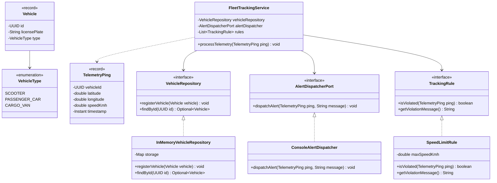

# Technical University of Moldova
## Faculty of Computers, Informatics and Microelectronics
### Department of Software Engineering and Automatics

---

# Laboratory Work Nr. 1
## Topic: SOLID Principles in Software Architecture
**Course:** Tehnici de Modelare și Programare Software (TMPS)  
**Author:** Tihon Aurelian-Mihai, FAF-241  

---

## 1. Objectives and theory
The primary objective of this laboratory work is to implement a domain model following the fundamental object-oriented architecture principles known as SOLID:
1. **Single Responsibility Principle (SRP):** Every module or class should have responsibility over a single part of the functionality provided by the software, meaning it has only one reason to change.
2. **Open/Closed Principle (OCP):** Software entities should be open for extension, but closed for modification.
3. **Dependency Inversion Principle (DIP):** High-level modules should not depend on low-level modules; both should depend on abstractions.

---

## 2. Project description
**ManaCar** is a telemetry and fleet management platform designed to monitor vehicles, track geographic telemetry pings, and enforce compliance rules (such as speed limits) in real time.

---

## 3. SOLID principles implementation

### A. Single responsibility principle (SRP)
* `TelemetryPing` and `Vehicle`: represent domain state and invariants using Java `record` constructs without persistence or presentation logic.
* `FleetTrackingService`: coordinates telemetry ingestion and evaluation against rules, delegating dispatching and querying.
* `ConsoleAlertDispatcher`: formats and outputs violation alerts to the standard output.

### B. Open/closed principle (OCP)
* Rule evaluation is abstracted behind the `TrackingRule` interface.
* Specific rules, such as `SpeedLimitRule`, implement this interface. Additional business constraints (e.g. geofencing or battery thresholds) can be introduced by creating new `TrackingRule` implementations without altering `FleetTrackingService`.

### C. Dependency inversion principle (DIP)
* High-level business logic in `FleetTrackingService` depends on domain abstractions (`VehicleRepository`, `AlertDispatcherPort`, `TrackingRule`) rather than concrete classes.
* Concrete implementations (`InMemoryVehicleRepository`, `ConsoleAlertDispatcher`) are injected into the service at runtime.

---

## 4. UML class diagram



---

## 5. Execution results

```text
ManaCar fleet telemetry tracking
Status: telemetry ping recorded within normal parameters.
[alert] timestamp: 2026-10-06T10:15:30Z | coordinates: (47.0290, 28.8390) | speed: 96.2 km/h | reason: [CARGO_VAN - MD-TR-102] Speed limit exceeded (80.0 km/h allowed)
```

---

## 6. Conclusions

Applying SRP, OCP, and DIP decouples domain entities from storage and presentation mechanisms. The resulting architecture allows adding new tracking policies and replacing repositories or dispatchers without modifying core business rules.
