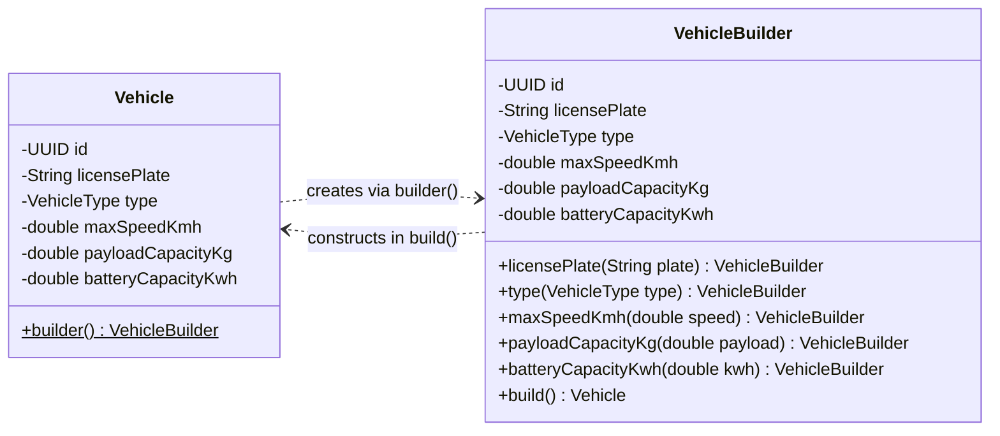
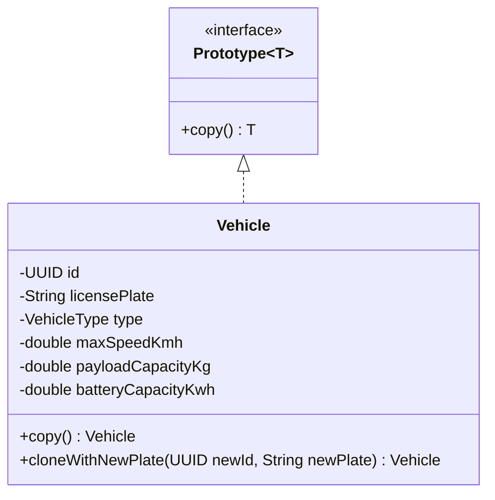
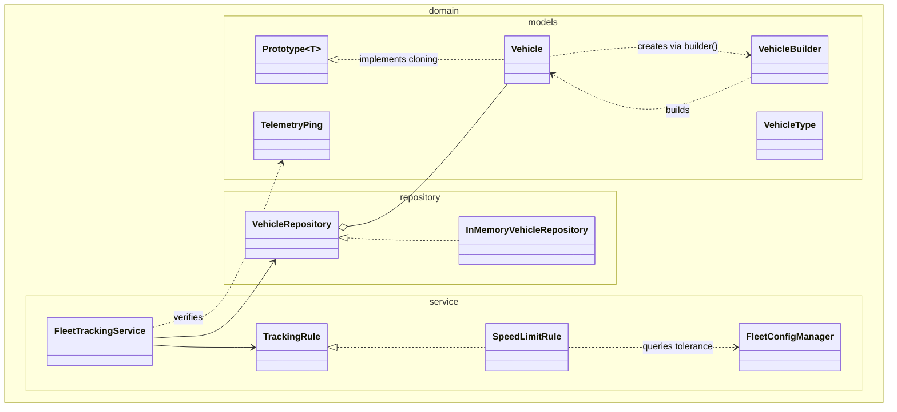

# Technical University of Moldova
## Faculty of Computers, Informatics and Microelectronics
### Department of Software Engineering and Automatics

---

# Laboratory Work Nr. 1
## Topic: Creational Design Patterns
**Course:** Tehnici de Modelare și Programare Software (TMPS)  
**Author:** Tihon Aurelian-Mihai, FAF-241  

---

## 1. Objectives and theoretical background

### Objectives
1. Study and analyze the architectural motivations and trade-offs behind Creational Design Patterns.
2. Formulate appropriate object instantiation mechanisms within an object-oriented domain.
3. Implement three distinct creational patterns within a cohesive, scalable software platform without third-party frameworks.
4. Establish clean architectural separation across domain, model, repository, and client packages.

### Theoretical background
Creational design patterns manage object creation mechanics, aiming to instantiate objects in a manner best suited to the situation while abstracting instantiation details away from client logic. Direct instantiation via the `new` operator frequently scatters concrete dependencies across the codebase, resulting in tight coupling, inflexible extension points, and code duplication.

Rather than introducing heavyweight factory hierarchies that add unwarranted indirection in focused domains, three complementary creational patterns were selected:
* **Builder:** Separates the construction of complex objects from their structural representation, enabling step-by-step assembly with invariant enforcement and avoiding telescoping constructors.
* **Prototype:** Enables creating new objects by cloning an existing prototype instance, eliminating the overhead of repeated configuration when provisioning batches of similar entities.
* **Singleton:** Guarantees that a class possesses only one instance across the entire runtime environment, offering a global, thread-safe access point without public mutable global state.

---

## 2. Project description

Building directly upon the foundation established in **Lab 0 (SOLID Principles)**, the **ManaCar** fleet telemetry platform has been extended into a modular vehicle provisioning and tracking architecture.

ManaCar tracks municipal scooters, passenger cars, and commercial cargo vans. As fleet sizes scale, vehicle creation cannot remain hardcoded in driver routines. The system requires:
1. Custom configurations with specific speed governors, payload thresholds, and battery capacities (handled via **Builder**).
2. Rapid fleet replication from archetype template vehicles (handled via **Prototype**).
3. Centralized, immutable runtime parameters such as speed tolerances and regional coordinates (handled via **Singleton**).

### Package organization
Following the modular structure guidelines, the project is structured as follows:
* `client`: Console user interface (`FleetConsoleTui`), system entrypoint (`Main`), and test suite (`FleetCreationalTest`).
* `domain.models`: Domain models and immutable records (`Vehicle`, `VehicleBuilder`, `VehicleType`, `TelemetryPing`, `Prototype`).
* `domain.repository`: Storage contracts and memory-backed thread-safe implementations (`VehicleRepository`, `InMemoryVehicleRepository`).
* `domain.service`: Tracking services, policy rules, and system configuration (`FleetConfigManager`, `FleetTrackingService`, `SpeedLimitRule`, `ConsoleAlertDispatcher`).

---

## 3. Creational design patterns implementation

### A. Builder pattern

#### Problem and rationale
A `Vehicle` in ManaCar requires several configuration attributes: identifier, license plate, vehicle type, maximum governed speed, payload capacity, and battery kilowatt-hour capacity. Relying on telescoping constructors creates error-prone call sites, where adjacent numeric arguments (such as speed versus payload) can be accidentally transposed. Furthermore, creating separate sub-classes or specialized factory hierarchies for every minor permutation leads to class explosion without real benefit.

#### Solution
The `VehicleBuilder` class provides a fluent, step-by-step construction process. Invariants are validated prior to instantiation in `build()`, while the `Vehicle` constructor remains simple, encapsulated, and minimal:

```java
package domain.models;

public final class VehicleBuilder {
    private UUID id = UUID.randomUUID();
    private String licensePlate;
    private VehicleType type = VehicleType.PASSENGER_CAR;
    private double maxSpeedKmh = 130.0;
    private double payloadCapacityKg = 400.0;
    private double batteryCapacityKwh = 0.0;

    public VehicleBuilder licensePlate(String licensePlate) {
        this.licensePlate = Objects.requireNonNull(licensePlate, "License plate cannot be null");
        return this;
    }

    public VehicleBuilder maxSpeedKmh(double maxSpeedKmh) {
        if (maxSpeedKmh <= 0) {
            throw new IllegalArgumentException("Max speed must be strictly positive");
        }
        this.maxSpeedKmh = maxSpeedKmh;
        return this;
    }

    public Vehicle build() {
        if (licensePlate == null || licensePlate.isBlank()) {
            throw new IllegalStateException("License plate must be configured before building Vehicle");
        }
        return new Vehicle(id, licensePlate.strip(), type, maxSpeedKmh, payloadCapacityKg, batteryCapacityKwh);
    }
}
```

Client usage avoids verbose traditional syntax and leverages modern Java `var`:

```java
var customEv = Vehicle.builder()
        .licensePlate("MD-EV-777")
        .type(VehicleType.PASSENGER_CAR)
        .maxSpeedKmh(150.0)
        .payloadCapacityKg(420.0)
        .batteryCapacityKwh(77.5)
        .build();
```

#### UML diagram: Builder


---

### B. Prototype pattern

#### Problem and rationale
Fleet operators frequently register batches of vehicles belonging to identical commercial models (such as an order of identical courier vans). Manually re-specifying payload, dimensions, and battery ratings for dozens of units introduces human error and redundant logic.

#### Solution
The `Prototype<T>` interface establishes a cloning contract. The `Vehicle` class implements `cloneWithNewPlate()`, allowing existing template instances to produce deep duplicates equipped with a fresh unique identifier and distinct registration plate:

```java
package domain.models;

public interface Prototype<T> {
    T copy();
}

public final class Vehicle implements Prototype<Vehicle> {
    // ...
    @Override
    public Vehicle copy() {
        return new Vehicle(id, licensePlate, type, maxSpeedKmh, payloadCapacityKg, batteryCapacityKwh);
    }

    public Vehicle cloneWithNewPlate(UUID newId, String newPlate) {
        return new Vehicle(newId, newPlate, type, maxSpeedKmh, payloadCapacityKg, batteryCapacityKwh);
    }
}
```

#### UML diagram: Prototype


---

### C. Singleton pattern

#### Problem and rationale
The fleet telemetry system relies on global operating parameters: regional identifiers, default ingestion intervals, and legal speed tolerance margins. If configuration parameters were instantiated arbitrarily across services, inconsistent settings could lead to divergent compliance evaluations.

#### Solution
`FleetConfigManager` implements the Bill Pugh Singleton idiom using a static inner holder class. This guarantees thread-safe, lazy initialization without synchronization overhead:

```java
package domain.service;

public final class FleetConfigManager {
    private final String fleetRegion;
    private final int telemetryPingIntervalSec;
    private final double speedToleranceKmh;
    private final String systemVersion;

    private FleetConfigManager() {
        this.fleetRegion = "EU-MD-CHISINAU";
        this.telemetryPingIntervalSec = 5;
        this.speedToleranceKmh = 3.0;
        this.systemVersion = "2.1.0-creational";
    }

    private static final class Holder {
        private static final FleetConfigManager INSTANCE = new FleetConfigManager();
    }

    public static FleetConfigManager getInstance() {
        return Holder.INSTANCE;
    }

    public double speedToleranceKmh() {
        return speedToleranceKmh;
    }
}
```

#### UML diagram: Singleton
```mermaid
classDiagram
    direction TB

    class FleetConfigManager {
        -String fleetRegion
        -int telemetryPingIntervalSec
        -double speedToleranceKmh
        -String systemVersion
        -FleetConfigManager()
        +getInstance()$ FleetConfigManager
        +fleetRegion() String
        +telemetryPingIntervalSec() int
        +speedToleranceKmh() double
        +systemVersion() String
    }

    class Holder {
        -FleetConfigManager INSTANCE$
    }

    FleetConfigManager +-- Holder
```

---

## 4. Overall system architecture

The interplay of all three implemented creational patterns inside the domain architecture is illustrated below:



---

## 5. Execution results

### Automated demonstration mode (`--demo`)

```text
ManaCar Creational Design Patterns Demonstration
1. Singleton Pattern configuration: region=EU-MD-CHISINAU, speedTolerance=3.0 km/h, version=2.1.0-creational

2. Builder Pattern instantiation:
 - Constructed via VehicleBuilder: CARGO_VAN [MD-TR-900] - maxSpeed: 90 km/h, payload: 1800 kg, battery: 0.0 kWh (id: 74a24776-10d7-472b-95e0-da85e26132f6)
 - Constructed via VehicleBuilder: PASSENGER_CAR [MD-EV-777] - maxSpeed: 150 km/h, payload: 420 kg, battery: 77.5 kWh (id: 2ad9c4d9-0e64-4d9b-9e86-47696758c9d0)

3. Prototype Pattern instantiation:
 - Original template vehicle: CARGO_VAN [MD-TR-900] - maxSpeed: 90 km/h, payload: 1800 kg, battery: 0.0 kWh (id: 74a24776-10d7-472b-95e0-da85e26132f6)
 - Cloned unit via Prototype: CARGO_VAN [MD-TR-901] - maxSpeed: 90 km/h, payload: 1800 kg, battery: 0.0 kWh (id: 56c5badc-dbda-44c1-8916-a53fdaa7c4f9)

4. Telemetry Ingestion & Compliance Evaluation:
Ingesting normal telemetry for EV (speed: 120.0 km/h, max: 150.0 km/h):
Status: telemetry ping recorded within normal parameters.
Ingesting excessive speed telemetry for cargo van (speed: 98.5 km/h, max: 90.0 km/h):
[alert] timestamp: 2026-10-23T14:06:52Z | coordinates: (47.0290, 28.8390) | speed: 98.5 km/h | reason: [CARGO_VAN - MD-TR-900] Speed limit exceeded (max allowed: 90.0 km/h)
```

### Interactive TUI session trace

```text
ManaCar Fleet Telemetry Management
1. Build custom vehicle (Builder)
2. Clone vehicle from template (Prototype)
3. List registered fleet vehicles
4. Ingest telemetry ping
5. Remove vehicle
6. Inspect system configuration (Singleton)
0. Exit
> 1
Enter license plate: MD-NEW-99
Select type (SCOOTER / PASSENGER_CAR / CARGO_VAN): SCOOTER
Enter max speed (km/h) [e.g. 110.0]: 28.0
Enter payload capacity (kg) [e.g. 350.0]: 20.0
Enter battery capacity (kWh) [e.g. 0.0]: 3.5
Constructed via VehicleBuilder: SCOOTER [MD-NEW-99] - maxSpeed: 28 km/h, payload: 20 kg, battery: 3.5 kWh (id: 131bad5a-5e71-4c16-825f-2cd532a4edab)

ManaCar Fleet Telemetry Management
1. Build custom vehicle (Builder)
2. Clone vehicle from template (Prototype)
3. List registered fleet vehicles
4. Ingest telemetry ping
5. Remove vehicle
6. Inspect system configuration (Singleton)
0. Exit
> 2
Available template vehicles:
 1. SCOOTER [MD-SC-001] - maxSpeed: 25 km/h, payload: 15 kg, battery: 2.8 kWh (id: 5d1e3625-52db-43bb-a689-3a2a65b90130)
 2. PASSENGER_CAR [MD-PC-550] - maxSpeed: 130 km/h, payload: 450 kg, battery: 0.0 kWh (id: 1d526e98-9d95-407b-a51e-b8d77e00bddf)
 3. SCOOTER [MD-NEW-99] - maxSpeed: 28 km/h, payload: 20 kg, battery: 3.5 kWh (id: 131bad5a-5e71-4c16-825f-2cd532a4edab)
 4. CARGO_VAN [MD-TR-102] - maxSpeed: 90 km/h, payload: 1800 kg, battery: 0.0 kWh (id: 4ac821b8-174f-4b90-abfe-be99994e9e0f)
Select index to clone: 1
Enter new license plate: MD-CLONE-99
Cloned via Prototype: SCOOTER [MD-CLONE-99] - maxSpeed: 25 km/h, payload: 15 kg, battery: 2.8 kWh (id: 7fb128d3-1c00-4dd5-a16c-9ffb79b9b6c6)

ManaCar Fleet Telemetry Management
1. Build custom vehicle (Builder)
2. Clone vehicle from template (Prototype)
3. List registered fleet vehicles
4. Ingest telemetry ping
5. Remove vehicle
6. Inspect system configuration (Singleton)
0. Exit
> 3
Registered fleet vehicles (5 units):
 - SCOOTER [MD-SC-001] - maxSpeed: 25 km/h, payload: 15 kg, battery: 2.8 kWh (id: 5d1e3625-52db-43bb-a689-3a2a65b90130)
 - PASSENGER_CAR [MD-PC-550] - maxSpeed: 130 km/h, payload: 450 kg, battery: 0.0 kWh (id: 1d526e98-9d95-407b-a51e-b8d77e00bddf)
 - CARGO_VAN [MD-TR-102] - maxSpeed: 90 km/h, payload: 1800 kg, battery: 0.0 kWh (id: 4ac821b8-174f-4b90-abfe-be99994e9e0f)
 - SCOOTER [MD-NEW-99] - maxSpeed: 28 km/h, payload: 20 kg, battery: 3.5 kWh (id: 131bad5a-5e71-4c16-825f-2cd532a4edab)
 - SCOOTER [MD-CLONE-99] - maxSpeed: 25 km/h, payload: 15 kg, battery: 2.8 kWh (id: 7fb128d3-1c00-4dd5-a16c-9ffb79b9b6c6)
```

---

## 6. Conclusions

In this laboratory work, the ManaCar telemetry management platform was advanced from its initial SOLID baseline into a decoupled creational architecture focused on three practical patterns: the Builder Pattern, the Prototype Pattern, and the Singleton Pattern. The Builder Pattern eliminated the vulnerabilities associated with parameter ordering and telescoping constructors, enabling disciplined step-by-step assembly and invariant verification before committing immutable vehicle entities to memory. In parallel, the Prototype Pattern established a rapid mechanism for cloning archetype fleet configurations, accelerating batch onboarding workflows while avoiding redundant parameter declarations across consumer modules. Centralized operational parameters, including legal speed tolerance margins and ingestion timing, were unified under the Singleton Pattern utilizing Bill Pugh's static inner holder, guaranteeing lazy thread-safe initialization without mutable global state or synchronization bottlenecks.

A deliberate architectural decision was made to omit generic Factory hierarchies. In a focused domain model, introducing artificial factory interfaces creates boilerplate without functional necessity; combining Builder and Prototype delivers both parameter flexibility and rapid instantiation while keeping the codebase cohesive, minimal, and free of over-engineering. Furthermore, strict adherence to object-oriented constraints—specifically encapsulating all state behind private final fields, keeping constructors strictly assignment-focused, and leveraging modern Java idioms such as local-variable type inference and records—safeguarded the codebase against anti-patterns and generic boilerplate. Ultimately, this laboratory established an extensible, decoupled architectural foundation that directly prepares the ManaCar platform for Structural Design Patterns in Laboratory Work Nr. 2.

