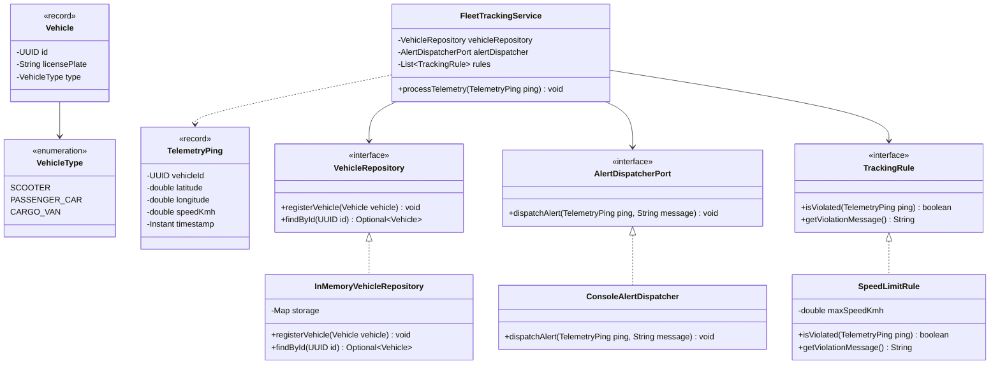

# Technical University of Moldova
## Faculty of Computers, Informatics and Microelectronics
### Department of Software Engineering and Automatics

---

# Laboratory Work Nr. 1
## Topic: SOLID Principles in Software Architecture
**Course:** Tehnici de Modelare și Programare Software (TMPS)  
**Author:** Tihon Aurelian-Mihai, FAF-241  

---

## 1. Objectives and theory
The primary objective of this laboratory work is to implement a domain model following the fundamental object-oriented architecture principles known as SOLID:
1. **Single Responsibility Principle (SRP):** Every module or class should have responsibility over a single part of the functionality provided by the software, meaning it has only one reason to change.
2. **Open/Closed Principle (OCP):** Software entities should be open for extension, but closed for modification.
3. **Dependency Inversion Principle (DIP):** High-level modules should not depend on low-level modules; both should depend on abstractions.

---

## 2. Project description
**ManaCar** is a telemetry and fleet management platform designed to monitor vehicles, track geographic telemetry pings, and enforce compliance rules (such as speed limits) in real time.

---

## 3. SOLID principles implementation

### A. Single responsibility principle (SRP)
* `TelemetryPing` and `Vehicle`: represent domain state and invariants using Java `record` constructs without persistence or presentation logic.
* `FleetTrackingService`: coordinates telemetry ingestion and evaluation against rules, delegating dispatching and querying.
* `ConsoleAlertDispatcher`: formats and outputs violation alerts to the standard output.

### B. Open/closed principle (OCP)
Rule evaluation is abstracted behind the `TrackingRule` contract. Adding new validation logic (e.g. geofencing or battery thresholds) only requires a new implementation without modifying existing evaluation flows:

```java
public interface TrackingRule {
    boolean isViolated(TelemetryPing ping);

    String getViolationMessage();
}

public final class SpeedLimitRule implements TrackingRule {
    private final double maxSpeedKmh;

    public SpeedLimitRule(double maxSpeedKmh) {
        if (maxSpeedKmh <= 0) {
            throw new IllegalArgumentException("Speed limit must be strictly positive");
        }
        this.maxSpeedKmh = maxSpeedKmh;
    }

    @Override
    public boolean isViolated(TelemetryPing ping) {
        return ping.speedKmh() > maxSpeedKmh;
    }

    @Override
    public String getViolationMessage() {
        return "Speed limit exceeded (" + maxSpeedKmh + " km/h allowed)";
    }
}
```

### C. Dependency inversion principle (DIP)
`FleetTrackingService` depends exclusively on abstractions injected at runtime (`VehicleRepository`, `AlertDispatcherPort`, and `TrackingRule`) rather than concrete data access or logging mechanisms:

```java
public final class FleetTrackingService {
    private final VehicleRepository vehicleRepository;
    private final AlertDispatcherPort alertDispatcher;
    private final List<TrackingRule> rules;

    public FleetTrackingService(
            VehicleRepository vehicleRepository,
            AlertDispatcherPort alertDispatcher,
            List<TrackingRule> rules) {
        this.vehicleRepository = Objects.requireNonNull(vehicleRepository);
        this.alertDispatcher = Objects.requireNonNull(alertDispatcher);
        this.rules = List.copyOf(rules);
    }

    public void processTelemetry(TelemetryPing ping) {
        var vehicle = vehicleRepository.findById(ping.vehicleId())
                .orElseThrow(() -> new IllegalArgumentException("Unknown vehicle with ID: " + ping.vehicleId()));

        for (var rule : rules) {
            if (rule.isViolated(ping)) {
                var message = "[%s - %s] %s".formatted(
                        vehicle.type(),
                        vehicle.licensePlate(),
                        rule.getViolationMessage());
                alertDispatcher.dispatchAlert(ping, message);
            }
        }
    }
}
```

---

## 4. UML class diagram



---

## 5. Execution results

```text
ManaCar fleet telemetry tracking
Status: telemetry ping recorded within normal parameters.
[alert] timestamp: 2026-10-06T10:15:30Z | coordinates: (47.0290, 28.8390) | speed: 96.2 km/h | reason: [CARGO_VAN - MD-TR-102] Speed limit exceeded (80.0 km/h allowed)
```

---

## 6. Conclusions

In this laboratory work, a fleet telemetry tracking platform, ManaCar, was developed to investigate and apply core SOLID design principles in software architecture. The system was structured by separating immutable domain representations (`Vehicle`, `TelemetryPing`) from operational logic, abstracting validation rules behind a polymorphic `TrackingRule` contract, and decoupling business workflows from infrastructure using repository and dispatcher ports. This modular design proved effective in enabling frictionless policy expansion under the Open/Closed Principle and establishing clean testability through dependency inversion. A notable challenge arose during rule boundary design, specifically balancing rule autonomy with contextual vehicle metadata without leaking repository dependencies directly into rule evaluators. Ultimately, adhering to these architectural guidelines yielded a robust, low-coupled codebase that establishes a clean foundation for subsequent design patterns in future laboratory assignments.
