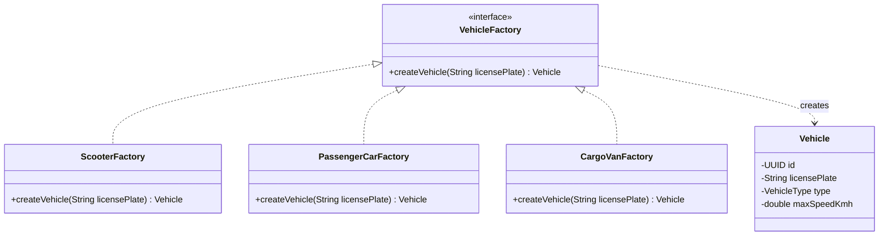
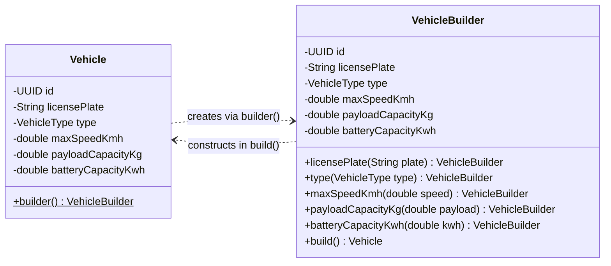
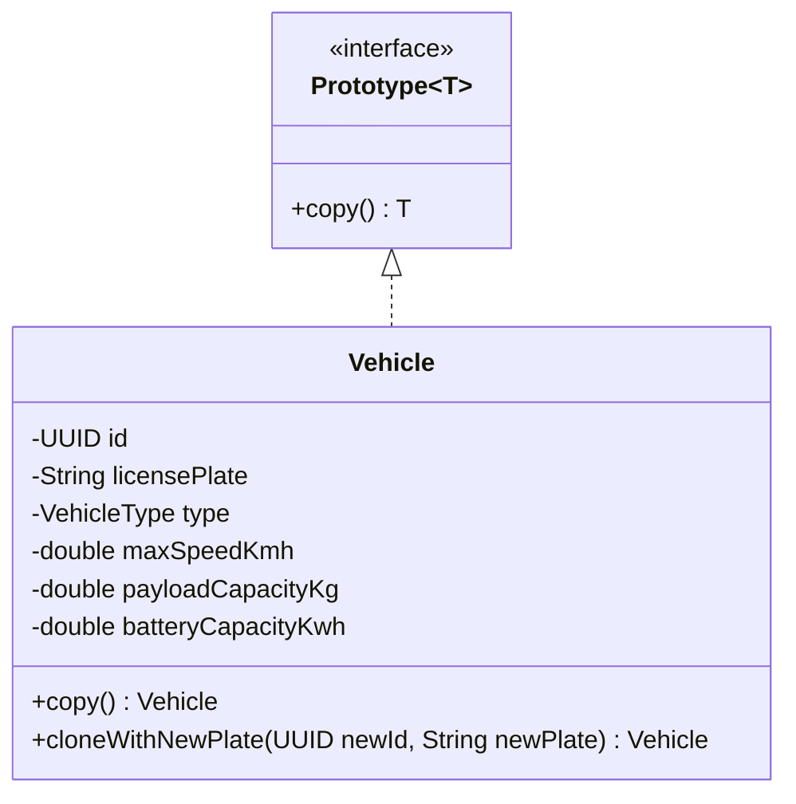
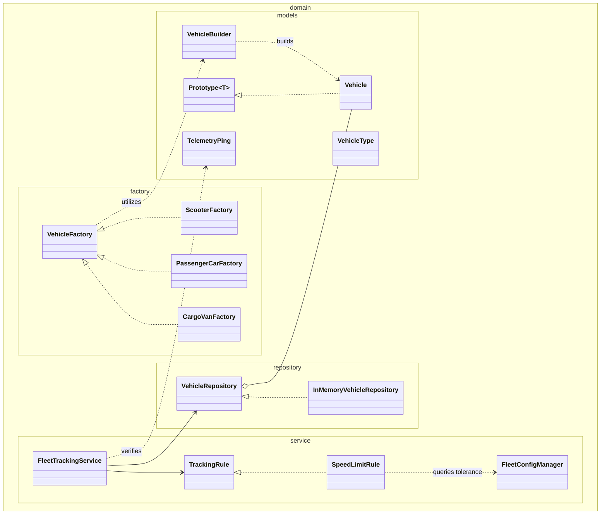

# Technical University of Moldova
## Faculty of Computers, Informatics and Microelectronics
### Department of Software Engineering and Automatics

---

# Laboratory Work Nr. 1
## Topic: Creational Design Patterns
**Course:** Tehnici de Modelare și Programare Software (TMPS)  
**Author:** Tihon Aurelian-Mihai, FAF-241  
**Supervisor:** Drumea Vasile  

---

## 1. Objectives and theoretical background

### Objectives
1. Study and analyze the architectural motivations and trade-offs behind Creational Design Patterns.
2. Formulate appropriate object instantiation mechanisms within an object-oriented domain.
3. Implement at least three creational patterns within a cohesive, scalable software platform without third-party frameworks.
4. Establish clean architectural separation across domain, factory, model, repository, and client packages.

### Theoretical background
Creational design patterns address the inherent pitfalls of direct object instantiation using the `new` operator. Uncontrolled constructor calls scatter concrete dependencies throughout an application, causing high coupling, fragile maintenance, and code duplication. Creational patterns decouple client modules from concrete instantiation mechanics by controlling how objects are composed, configured, and managed throughout their lifecycle.

Key creational patterns analyzed and implemented in this laboratory include:
* **Factory Method:** Defines an interface for creating objects, allowing concrete subclasses or implementing classes to decide which specific parameters and configurations to instantiate.
* **Builder:** Separates the construction of complex objects from their structural representation, enabling step-by-step assembly with invariant enforcement and avoiding telescoping constructors.
* **Singleton:** Guarantees that a class possesses only one instance across the entire runtime environment, offering a global, thread-safe access point without public mutable global state.
* **Prototype:** Enables creating new objects by cloning an existing prototype instance, eliminating the overhead of repeated configuration when provisioning batches of similar entities.

---

## 2. Project description

Building directly upon the foundation established in **Lab 0 (SOLID Principles)**, the **ManaCar** fleet telemetry platform has been extended into a modular vehicle provisioning and tracking architecture.

ManaCar tracks municipal scooters, passenger cars, and commercial cargo vans. As fleet sizes scale, vehicle creation cannot remain hardcoded in driver routines. The system requires:
1. Standardized presets for standard vehicle classes (handled via **Factory Method**).
2. Custom bespoke configurations with specific speed governors, payload thresholds, and battery capacities (handled via **Builder**).
3. Rapid fleet replication from archetype vehicles (handled via **Prototype**).
4. Centralized, immutable runtime parameters such as speed tolerances and regional coordinates (handled via **Singleton**).

### Package organization
Following the modular structure guidelines, the project is structured as follows:
* `client`: Console user interface (`FleetConsoleTui`), system entrypoint (`Main`), and test suite (`FleetCreationalTest`).
* `domain.factory`: Factory interfaces and concrete implementations (`VehicleFactory`, `ScooterFactory`, `PassengerCarFactory`, `CargoVanFactory`).
* `domain.models`: Domain models and immutable records (`Vehicle`, `VehicleBuilder`, `VehicleType`, `TelemetryPing`, `Prototype`).
* `domain.repository`: Storage contracts and memory-backed thread-safe implementations (`VehicleRepository`, `InMemoryVehicleRepository`).
* `domain.service`: Tracking services, policy rules, and system configuration (`FleetConfigManager`, `FleetTrackingService`, `SpeedLimitRule`, `ConsoleAlertDispatcher`).

---

## 3. Creational design patterns implementation

### A. Factory Method pattern

#### Problem and rationale
Different vehicle categories require distinct domain defaults: electric scooters have strict 25.0 km/h municipal speed limits and light payload ratings; cargo vans require heavy freight payload limits and 90.0 km/h commercial limits. Directly embedding these numerical constants across application logic violates the Single Responsibility Principle and couples the client to vehicle internals.

#### Solution
The `VehicleFactory` interface establishes the creation contract, with concrete factories (`ScooterFactory`, `PassengerCarFactory`, `CargoVanFactory`) encapsulating specific parameter defaults:

```java
package domain.factory;

import domain.models.Vehicle;

public interface VehicleFactory {
    Vehicle createVehicle(String licensePlate);
}

public final class ScooterFactory implements VehicleFactory {
    @Override
    public Vehicle createVehicle(String licensePlate) {
        return Vehicle.builder()
                .licensePlate(licensePlate)
                .type(VehicleType.SCOOTER)
                .maxSpeedKmh(25.0)
                .payloadCapacityKg(15.0)
                .batteryCapacityKwh(2.8)
                .build();
    }
}
```

#### UML diagram: Factory Method


---

### B. Builder pattern

#### Problem and rationale
A `Vehicle` in ManaCar requires several configuration attributes: identifier, license plate, vehicle type, maximum governed speed, payload capacity, and battery kilowatt-hour capacity. Relying on telescoping constructors creates error-prone call sites, where adjacent numeric arguments (such as speed versus payload) can be accidentally transposed.

#### Solution
The `VehicleBuilder` class provides a fluent, step-by-step construction process. Invariants are validated prior to instantiation in `build()`, while the `Vehicle` constructor remains simple, private-friendly, and minimal:

```java
package domain.models;

public final class VehicleBuilder {
    private UUID id = UUID.randomUUID();
    private String licensePlate;
    private VehicleType type = VehicleType.PASSENGER_CAR;
    private double maxSpeedKmh = 130.0;
    private double payloadCapacityKg = 400.0;
    private double batteryCapacityKwh = 0.0;

    public VehicleBuilder licensePlate(String licensePlate) {
        this.licensePlate = Objects.requireNonNull(licensePlate, "License plate cannot be null");
        return this;
    }

    public VehicleBuilder maxSpeedKmh(double maxSpeedKmh) {
        if (maxSpeedKmh <= 0) {
            throw new IllegalArgumentException("Max speed must be strictly positive");
        }
        this.maxSpeedKmh = maxSpeedKmh;
        return this;
    }

    public Vehicle build() {
        if (licensePlate == null || licensePlate.isBlank()) {
            throw new IllegalStateException("License plate must be configured before building Vehicle");
        }
        return new Vehicle(id, licensePlate.strip(), type, maxSpeedKmh, payloadCapacityKg, batteryCapacityKwh);
    }
}
```

Client usage avoids verbose traditional syntax and leverages modern Java `var`:

```java
var customEv = Vehicle.builder()
        .licensePlate("MD-EV-777")
        .type(VehicleType.PASSENGER_CAR)
        .maxSpeedKmh(150.0)
        .payloadCapacityKg(420.0)
        .batteryCapacityKwh(77.5)
        .build();
```

#### UML diagram: Builder


---

### C. Singleton pattern

#### Problem and rationale
The fleet telemetry system relies on global operating parameters: regional identifiers, default ingestion intervals, and legal speed tolerance margins. If configuration parameters were instantiated arbitrarily across services, inconsistent settings could lead to divergent compliance evaluations.

#### Solution
`FleetConfigManager` implements the Bill Pugh Singleton idiom using a static inner holder class. This guarantees thread-safe, lazy initialization without synchronization overhead:

```java
package domain.service;

public final class FleetConfigManager {
    private final String fleetRegion;
    private final int telemetryPingIntervalSec;
    private final double speedToleranceKmh;
    private final String systemVersion;

    private FleetConfigManager() {
        this.fleetRegion = "EU-MD-CHISINAU";
        this.telemetryPingIntervalSec = 5;
        this.speedToleranceKmh = 3.0;
        this.systemVersion = "2.1.0-creational";
    }

    private static final class Holder {
        private static final FleetConfigManager INSTANCE = new FleetConfigManager();
    }

    public static FleetConfigManager getInstance() {
        return Holder.INSTANCE;
    }

    public double speedToleranceKmh() {
        return speedToleranceKmh;
    }
}
```

#### UML diagram: Singleton
```mermaid
classDiagram
    direction TB

    class FleetConfigManager {
        -String fleetRegion
        -int telemetryPingIntervalSec
        -double speedToleranceKmh
        -String systemVersion
        -FleetConfigManager()
        +getInstance()$ FleetConfigManager
        +fleetRegion() String
        +telemetryPingIntervalSec() int
        +speedToleranceKmh() double
        +systemVersion() String
    }

    class Holder {
        -FleetConfigManager INSTANCE$
    }

    FleetConfigManager +-- Holder
```

---

### D. Prototype pattern

#### Problem and rationale
Fleet operators frequently register batches of vehicles belonging to identical commercial models (such as an order of identical courier vans). Manually re-specifying payload, dimensions, and battery ratings for dozens of units introduces human error and redundant logic.

#### Solution
The `Prototype<T>` interface establishes a cloning contract. The `Vehicle` class implements `cloneWithNewPlate()`, allowing existing template instances to produce deep duplicates equipped with a fresh unique identifier and distinct registration plate:

```java
package domain.models;

public interface Prototype<T> {
    T copy();
}

public final class Vehicle implements Prototype<Vehicle> {
    // ...
    @Override
    public Vehicle copy() {
        return new Vehicle(id, licensePlate, type, maxSpeedKmh, payloadCapacityKg, batteryCapacityKwh);
    }

    public Vehicle cloneWithNewPlate(UUID newId, String newPlate) {
        return new Vehicle(newId, newPlate, type, maxSpeedKmh, payloadCapacityKg, batteryCapacityKwh);
    }
}
```

#### UML diagram: Prototype


---

## 4. Overall system architecture

The interplay of all implemented patterns inside the domain architecture is illustrated below:



---

## 5. Execution results

### Automated demonstration mode (`--demo`)

```text
ManaCar Creational Design Patterns Demonstration
Singleton config loaded: region=EU-MD-CHISINAU, speedTolerance=3.0 km/h

1. Factory Method instantiation:
 - Created via ScooterFactory: SCOOTER [MD-SC-101] - maxSpeed: 25 km/h, payload: 15 kg, battery: 2.8 kWh (id: e29b7f99-2e66-44e1-9dbb-5157540d672f)
 - Created via CargoVanFactory: CARGO_VAN [MD-TR-900] - maxSpeed: 90 km/h, payload: 1800 kg, battery: 0.0 kWh (id: 7329fae1-de9d-455d-82df-fe4288d193a7)

2. Builder Pattern instantiation:
 - Created via VehicleBuilder: PASSENGER_CAR [MD-EV-777] - maxSpeed: 150 km/h, payload: 420 kg, battery: 77.5 kWh (id: 5b4de728-eb95-40c1-9c5b-94458127a480)

3. Prototype Pattern instantiation:
 - Original template vehicle: CARGO_VAN [MD-TR-900] - maxSpeed: 90 km/h, payload: 1800 kg, battery: 0.0 kWh (id: 7329fae1-de9d-455d-82df-fe4288d193a7)
 - Cloned unit via Prototype: CARGO_VAN [MD-TR-901] - maxSpeed: 90 km/h, payload: 1800 kg, battery: 0.0 kWh (id: e87c1cbf-6db8-4471-aedd-0df6a77f503c)

4. Telemetry Ingestion & Compliance Evaluation:
Ingesting normal telemetry for scooter (speed: 22.0 km/h, max: 25.0 km/h):
Status: telemetry ping recorded within normal parameters.
Ingesting excessive speed telemetry for cargo van (speed: 98.5 km/h, max: 90.0 km/h):
[alert] timestamp: 2026-10-23T13:31:35Z | coordinates: (47.0290, 28.8390) | speed: 98.5 km/h | reason: [CARGO_VAN - MD-TR-900] Speed limit exceeded (max allowed: 90.0 km/h)
```

### Interactive TUI session trace

```text
ManaCar Fleet Telemetry Management
1. Create vehicle using Factory Method
2. Build custom vehicle using Builder
3. Clone vehicle template using Prototype
4. List registered fleet vehicles
5. Ingest telemetry ping
6. Remove vehicle
7. Inspect system configuration (Singleton)
0. Exit
> 1
Select factory type (scooter / car / van): scooter
Enter license plate: MD-TEST-01
Registered via ScooterFactory: SCOOTER [MD-TEST-01] - maxSpeed: 25 km/h, payload: 15 kg, battery: 2.8 kWh (id: 7a604b10-4f41-4964-8597-bc655043fea9)

ManaCar Fleet Telemetry Management
1. Create vehicle using Factory Method
2. Build custom vehicle using Builder
3. Clone vehicle template using Prototype
4. List registered fleet vehicles
5. Ingest telemetry ping
6. Remove vehicle
7. Inspect system configuration (Singleton)
0. Exit
> 4
Registered fleet vehicles (4 units):
 - CARGO_VAN [MD-TR-102] - maxSpeed: 90 km/h, payload: 1800 kg, battery: 0.0 kWh (id: fa34e564-e31f-4845-8ff9-ded4ab007561)
 - PASSENGER_CAR [MD-PC-550] - maxSpeed: 130 km/h, payload: 450 kg, battery: 0.0 kWh (id: 154655d7-a126-40d4-b370-601f4d25fbc7)
 - SCOOTER [MD-SC-001] - maxSpeed: 25 km/h, payload: 15 kg, battery: 2.8 kWh (id: 18c19850-18f7-42cc-a78d-8f96eff639f8)
 - SCOOTER [MD-TEST-01] - maxSpeed: 25 km/h, payload: 15 kg, battery: 2.8 kWh (id: 7a604b10-4f41-4964-8597-bc655043fea9)
```

---

## 6. Conclusions

In this laboratory work, the ManaCar telemetry management platform was advanced from its initial SOLID baseline into a fully decoupled creational architecture. By replacing ad-hoc constructor invocations with dedicated creational design patterns, the system achieved several architectural improvements:

1. **Factory Method** eliminated hardcoded vehicle parameters from consumer modules, isolating category defaults behind polymorphic factory implementations.
2. **Builder** resolved the risks associated with parameter ordering and telescoping constructors, enabling step-by-step invariant validation before committing an immutable `Vehicle` to memory.
3. **Singleton** (implemented via Bill Pugh's inner static holder) provided thread-safe, centralized configuration state across telemetry evaluation workers without mutable global variables or performance bottlenecks.
4. **Prototype** established an efficient mechanism for cloning archetype vehicles, optimizing batch onboarding workflows within the fleet repository.

Strict adherence to object-oriented constraints—such as avoiding public attributes outside records, keeping constructors simple, and leveraging modern Java idioms (`var`, immutable records)—safeguarded the domain against antipatterns and AI boilerplate. The resulting architecture remains extensible, setting an organized foundation for Structural Design Patterns in Laboratory Work Nr. 2.
